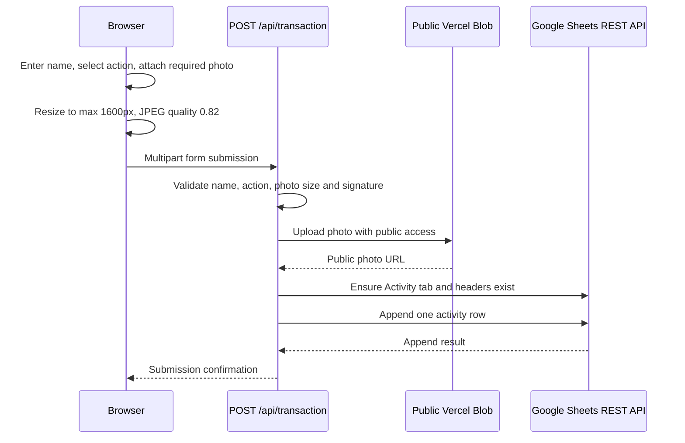

# EmmaStorage Tracker: Architecture

The simplified Emmanuel app records one activity per submission: free-text
name, Take / Return / Consume segmented selection, and a required photo for
every action. There is no stock, catalog, people list, admin workflow, or
dashboard. Google Sheets stores activity rows; public Vercel Blob stores photos.

## Components

| Component | Responsibility |
|---|---|
| [app/page.tsx](../app/page.tsx) | Static home page; no Google Sheet reads |
| [app/activity-form.tsx](../app/activity-form.tsx) | Client form; resize photos to a maximum 1600px dimension, JPEG quality `0.82` |
| [lib/activity.ts](../lib/activity.ts) | Validation: name maximum 100 characters, allowed actions, required photo, API maximum 3 MB, JPEG/PNG/WebP signatures |
| [app/api/transaction/route.ts](../app/api/transaction/route.ts) | Single activity endpoint: `POST /api/transaction` |
| [lib/activity-store.ts](../lib/activity-store.ts) | `google-auth-library` JWT service-account authentication, Sheets REST calls, public Blob uploads |
| Google Sheets | Auto-created `Activity` tab; existing `Items`, `People`, and `Log` untouched |
| Vercel Blob | Public photo URLs used by Sheet `IMAGE` formulas |

Next.js App Router, Tailwind CSS, and PWA support remain. The synced app name is
**EmmaStorage Tracker**. Cobalt, teal, and gold inspire the theme; the actual
supplied logo has not been saved in the workspace.

## Submission Flow

The `Activity` columns are **Time UTC**, **Name**, **Action**, **Photo**,
**Photo URL**, and **Entry ID**. `Photo` contains an
`=IMAGE("https://...")` formula; `Photo URL` preserves the public URL separately.
The backend uses four server-side environment variables:
`GOOGLE_SERVICE_ACCOUNT_EMAIL`, `GOOGLE_PRIVATE_KEY`, `GOOGLE_SHEET_ID`, and
`BLOB_READ_WRITE_TOKEN`. `ADMIN_PASSWORD` is unused.

## Trust and Durability

- There is no login; a name does not establish verified identity. Anyone with
    the app link can submit, and anyone with a public photo URL can view it.
    Private or sensitive photos should not be used.
- `IMAGE` is URL-backed, not embedded image storage. Images **must not be
    deleted unless separately archived**. Excel exports may not embed images;
    verify exports and archive photos separately.
- Blob upload and Sheet append are not atomic. If upload succeeds and append
    fails, an orphan photo is retained rather than deleted.
- An append timeout has an ambiguous outcome: the row may have been written.
    Retrying can create a duplicate. Entry IDs support inspection but should not
    be treated as a guarantee of retry deduplication. There are no automatic retries.

## Verification Status

Use `npm test`, `npm run lint`, and `npm run build` for local checks. They do not
prove live Google Sheets and Blob integration. No deployment has been
performed, and no live end-to-end validation is claimed. Follow the
[setup guide](./admin-guide.md) to configure and verify a real submission.
